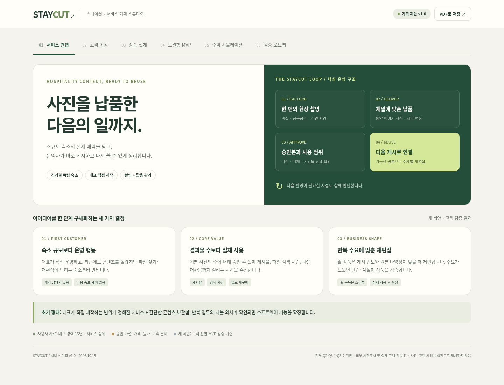

# STAYCUT · 스테이컷

소규모 숙소의 **촬영 → 채널별 납품 → 버전 승인 → 실제 게시 → 재활용**을 연결하는 서비스 기획안입니다.

초기에는 대표가 직접 제작하는 범위가 정해진 서비스로 시작하고, 반복 게시 수요와 원본이 충분한 숙소에 월 재편집을 제안합니다. 가격·원가·성과 목표는 검증 전 가설이며, 실제 고객 실적이나 완성된 운영 서비스가 아닙니다.



## 고객 포털 개발 · 선택 시안 2번

[Vercel에서 개발 화면 열기](https://staycut-snap.vercel.app) · 체험 홈은 가상 데이터이며, 고객 로그인·RLS 조회·승인/수정 저장 코드를 별도 실제 고객 모드로 연결했습니다. 실제 DB 적용·고객 배정·서명 키 설정은 [관리자 안내](docs/supabase-setup.md)를 참고하세요. GitHub 자동 배포 연결 오류가 남아 소스를 직접 업로드해 배포합니다.

[고객 포털 소스와 실행 안내](portal/README.md)에서 상단 탐색과 큰 숙소 사진을 사용한 반응형 프로토타입을 개발합니다. 홈 → 영상 검토·통합 수정 요청·정확한 버전 승인 → 게시용 콘텐츠·샘플 다운로드 → 게시 응답·재편집 문의를 연결했습니다.

```sh
npm run dev
npm test
npm run build
```

외부 npm 의존성 없이 Node.js 24.x에서 실행합니다. 도메인 26개·Auth 클라이언트 12개·파일 API/설정 26개의 단위 테스트와 정적 빌드가 통과했습니다. 기존 체험 화면의 Chromium 검증 6개에 모의 인증 고객 흐름 4개를 추가했습니다. 현재 프로젝트의 실제 사용자/DB 전체 검증은 관리자 설정 후 진행합니다. 실제 결제·SNS 게시 연동은 없습니다.

## 개발 환경 · Vercel + Supabase

앱/API는 Vercel, 로그인·DB·비공개 파일은 관리형 Supabase로 진행합니다. [연결 상태와 배포 안내](docs/deployment.md), [Supabase 데이터 기반](supabase/README.md)을 참고하세요. 제공받은 프로젝트의 공개 키와 Auth 접근은 확인했습니다. 테이블이 없어 새 DB 적용이 필요하며, 계정·멤버십·작업·검토용 파일 배정과 Vercel 서버 서명 키 등록도 남아 있습니다.

[기반 검증 CI](https://github.com/devdevra/snap/actions/runs/38750549206)에서 도메인 26개·다운로드 API 12개·DB 권한 회귀 판정 77개·빌드·Chromium 6개 항목이 통과했습니다. 실제 Vercel/Supabase 연결 검증은 계정 연결 후 진행합니다.

2026-10-16 [고객 로그인 연결 CI](https://github.com/devdevra/snap/actions/runs/38760315115)도 통과했습니다. 단위 테스트 64개·DB 판정 103개·체험 브라우저 6개·모의 고객 브라우저 4개를 확인했습니다. 배포된 홈·공개 설정·Auth 서버 접근은 정상이며 DB는 아직 `missing_schema`입니다. [고객 로그인 화면](https://staycut-snap.vercel.app/#account)의 실제 계정/파일 전체 검증은 관리자 설정 후 진행합니다.

## 최신 고도화 · v2

2026-10-15: 고객 선별, 상품·수정·결제·보관 경계, 실제 게시에서 유료 재편집으로 넘어가는 조건, CAC·영업·관리 노동을 포함한 손익과 실험 중단 기준을 구체화했습니다. 신규 조건과 숫자는 검증 전 제안입니다.

| 자료 | 내용 |
| --- | --- |
| [서비스 기획 v2](docs/service-plan-v2.md) | 좁힌 첫 고객, 실행 가능한 상품 범위, 총 노동 손익, 8주 파일럿 |
| [고객 포털 제품 명세](docs/product-spec.md) | 홈·검토함·콘텐츠, 버전 승인·사용권·게시 상태와 예외 |
| [홈 디자인 대안과 기능 화면](design/README.md) | 같은 홈 화면의 디자인 3개 + 기존 홈·보관함·검토 흐름 화면 |
| [산출물 검수 기록](docs/v2-review.json) | 문서 계산·참조·정적 이미지 확인 범위와 알려진 차이 |

시안 속 숙소와 이미지는 가상 예시입니다. 실제 제품을 구현하거나 고객 검증을 진행한 결과가 아닙니다. 원래 `index.html`, 기존 PDF 및 아래 50개 테스트 기록은 **v1 사업 설명용 프로토타입** 자료입니다. v2 시안의 구현·브라우저 테스트 결과로 해석하지 않습니다.

## 기존 기획 결과물 · v1

| 파일 | 내용 |
| --- | --- |
| [인터랙티브 기획안](index.html) | 서비스 컨셉, 고객 여정, 상품 설계, 보관함 시연, 수익 계산기, 검증 로드맵 |
| [상세 기획서](docs/service-plan.md) | 고객·운영·권리·MVP 설계, 인터뷰 질문, Q2·Q3 지원서 개선 문안 |
| [공유용 PDF](exports/staycut-service-plan.pdf) | 6쪽 시각화 문서 |
| [검증 기록](docs/validation-results.json) | 브라우저 동작·계산·모바일 배치 검증 결과 |

## 인터랙티브 기획안 열기

저장소를 내려받은 뒤 `index.html`을 브라우저에서 엽니다. 외부 라이브러리, 패키지 설치, API 키가 필요하지 않은 단일 HTML입니다. GitHub의 파일 보기 화면에서는 HTML이 실행되지 않으므로 파일을 내려받아 열어야 합니다.

- 상단 탭에서 여섯 기획 화면을 전환합니다.
- 고객 여정의 단계를 선택하면 고객 행동·운영 업무·산출물·완료 조건이 표시됩니다.
- 보관함에서 상태 필터, 예시 버전 승인, 수정 요청을 시연할 수 있습니다. 실제 파일 전달이나 메시지 발송은 없으며 변경은 새로고침하면 초기화됩니다.
- 수익 계산기에서 작업시간·건수·가격·제작 가능 시간을 조정합니다. 표시된 잔액은 노동비와 직접비 차감 후 금액이며 순이익이 아닙니다.
- 브라우저의 인쇄 기능으로 현재 시뮬레이션을 포함한 전체 기획안을 PDF로 저장할 수 있습니다. 저장소의 공유용 PDF는 기본 가정으로 내보낸 문서입니다.

## 검증 범위

기획안 제작 시 Chromium으로 탭·고객 여정·필터·승인 조건·계산기 경계값·모바일 화면 등 50개 항목을 점검했습니다. 마지막 레이아웃 조정 후 모바일 6개 화면의 가로 넘침과 PDF 6쪽 출력도 확인했습니다. 이 기록은 프로토타입 검증이며 고객 인터뷰, 유료 판매, 시장 검증을 수행했다는 의미가 아닙니다.

첫 촬영 69만원, 월 재편집 19만원은 부가세 별도 가격 가설입니다. 기본 계산 예시인 첫 촬영 월 2건과 재편집 8곳은 매출 290만원, 총 작업시간 48시간, 노동·직접비 차감 후 잔액 110만원입니다. 영업비·고정비·세금과 실제 고객 확보는 별도로 검증해야 합니다.

자료 기준: 2026년 10월 15일 · 사용자가 제공한 Q2·Q3-1·Q3-2 내용을 바탕으로 작성.

