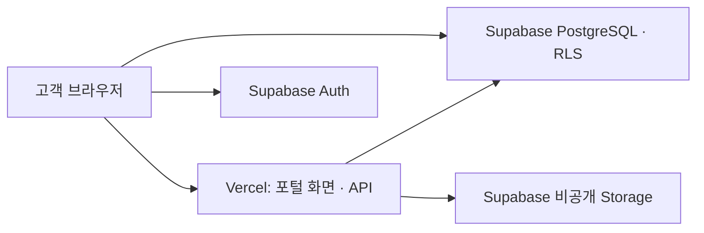

# Vercel + Supabase 개발 기반

2026-10-15 결정: 앱과 API는 **Vercel**, 로그인·PostgreSQL·비공개 파일은 **관리형 Supabase**를 사용합니다. 현재 프론트엔드를 유지하며 Convex를 중간 단계로 넣지 않습니다.



현재 배포 대상은 `portal/`을 빌드한 `dist/`와 `api/`의 Vercel Function입니다. 저장소 루트의 기존 기획용 `index.html`을 서비스 화면으로 배포하지 않습니다. 내부 메뉴는 해시로 이동하므로 전체 경로를 홈으로 바꾸는 rewrite는 필요하지 않습니다.

## 구현 상태

| 항목 | 현재 상태 |
| --- | --- |
| 선택한 2번 디자인 · 검토/콘텐츠 흐름 | 구현·브라우저 검증 완료, 가상 데이터 |
| Vercel 빌드 설정 | `vercel.json`, Node 24 권장, `npm run build` → `dist` |
| 숙소별 DB 격리 · 승인/수정 RPC | 마이그레이션 준비, 외부 프로젝트에는 미적용 |
| 비공개 다운로드 API | 사용자 인증·권한 검사 후 60초 서명 링크 발급 코드와 오프라인 테스트 준비 |
| 실제 로그인 · 화면의 DB 조회/저장 | 프로젝트 연결 후 구현 필요 |
| 업로드 · 권한 있는 미리보기 · 게시 기록 저장 | 후속 구현 필요 |
| 실제 결제 · 이메일 · SNS 게시 | 미연동 |

새 API는 현재 데모 화면에서 호출하지 않습니다. 환경변수를 입력하는 것만으로 데모 데이터가 실데이터로 바뀌거나 승인이 DB에 저장되지는 않습니다. 공개 `portal/assets/`는 가상 숙소 샘플 전용이며 실제 고객 파일을 이 폴더에 넣지 않습니다.

## 계정 연결

1. [Vercel Login Connections](https://vercel.com/account/authentication)에서 `devdevra` GitHub 계정을 연결하고 `devdevra/snap`에 대한 GitHub App 접근을 허용합니다. 현재 연결 시도는 `You need to add a Login Connection to your GitHub account first`로 실패했습니다. Vercel 프로젝트/배포 생성은 완료되지 않았습니다.
2. [Supabase Dashboard](https://supabase.com/dashboard)에서 개발용 프로젝트를 생성합니다. 리전은 서울을 우선하고, 없다면 Vercel Function과 가까운 리전을 선택합니다. `vercel.json`의 현재 Function 리전은 `icn1`입니다.
3. Supabase의 Project URL과 publishable key를 확인합니다. 비밀 키는 아래 Vercel 환경변수에 직접 입력합니다. DB 비밀번호·개인 토큰을 채팅이나 GitHub에 올리지 않습니다.

## Vercel 설정과 환경변수

저장소 가져오기 시 **Root Directory는 저장소 루트**, Framework Preset은 Other, Node.js는 24.x로 둡니다. Build Command와 Output Directory는 `vercel.json`을 따릅니다. 현재 구현 브랜치는 `codex/staycut-v2-design`입니다. 기본 브랜치 `codex/staycut-planning`에는 앱 변경이 아직 합쳐지지 않았으므로, 첫 확인 배포는 구현 브랜치의 Preview로 진행합니다.

| 환경변수 | 값과 용도 |
| --- | --- |
| `SUPABASE_URL` | 프로젝트의 HTTPS URL |
| `SUPABASE_PUBLISHABLE_KEY` | `sb_publishable_…`, 사용자 JWT와 함께 인증/권한 RPC 호출 |
| `SUPABASE_SECRET_KEY` | `sb_secret_…`, 서버에서 허가된 파일의 링크 서명에만 사용 |

신규 프로젝트는 [공식 API 키 안내](https://supabase.com/docs/guides/getting-started/api-keys)의 publishable/secret 키를 사용합니다. 기존 프로젝트의 `SUPABASE_ANON_KEY` / `SUPABASE_SERVICE_ROLE_KEY`도 호환하지만 새 구성에는 필요하지 않습니다. 비밀 키에는 공개 번들용 접두사를 붙이지 않습니다. 현재 정적 빌드는 환경변수를 브라우저 파일에 삽입하지 않습니다.

Preview/Development에는 개발용 Supabase를 연결하고 Production에는 별도 운영 프로젝트를 연결합니다. 비밀 키는 Vercel의 Secret 환경변수로 저장합니다. `.env.example`에는 변수 이름만 있으며 `.env.local`과 `.vercel/`은 Git에서 제외합니다.

## DB 적용과 연결 순서

올바른 개발 프로젝트에 연결하고 환경변수 이름을 확인한 뒤에만 마이그레이션을 적용합니다. [Supabase 기반 안내](../supabase/README.md)에 테이블·RPC 계약과 운영자 책임을 기록했습니다.

```sh
supabase login
supabase link --project-ref <개발-프로젝트-ref>
supabase db push --dry-run
supabase db push
```

위 명령은 아직 실행하지 않았습니다. `supabase/tests/`는 임시 CI DB 전용으로 실제 프로젝트에 적용하지 않습니다. 마이그레이션 이후 테스트 사용자를 생성하고, 신뢰된 운영자 경로로 숙소·멤버십·계약·파일을 배정해야 합니다. 계정 가입만으로 고객사 접근 권한이 생기지 않습니다.

이후 로그인 화면 → 사용자 JWT로 숙소/작업 조회 → 승인·수정 RPC 연결 → 비공개 미리보기/다운로드 → 새로고침 후 저장 상태 유지 순서로 실제 서비스를 연결합니다. 실제 Auth·Storage·Vercel 전체 흐름 검증 전에는 운영 전환이 완료된 것으로 보지 않습니다.

## 다운로드 API

`POST /api/download`, 헤더 `Authorization: Bearer <Supabase 사용자 access token>`, `Content-Type: application/json`.

```json
{"versionId":"UUID","channel":"instagram","purpose":"organic"}
```

호출자가 파일 경로나 사용자 ID를 지정할 수 없습니다. 서버는 사용자 토큰을 확인한 뒤 동일 사용자 권한으로 `authorize_asset_download` RPC를 호출합니다. RPC가 허가한 비공개 경로만 서버 비밀 키로 서명하며 `{ "url": "…", "expiresIn": 60 }`을 반환합니다. 응답은 캐시하지 않습니다. 파일 접근 철회 후에도 이미 발급한 링크는 남은 60초 이내 동안 유효할 수 있습니다.

## 검증

```sh
npm ci --ignore-scripts --no-audit --no-fund
npm test
npm run test:server
npm run build
```

GitHub Actions는 기존 Chromium 흐름과 별도로 임시 PostgreSQL 16에서 실제 마이그레이션/RLS/RPC 회귀 SQL을 실행합니다. Auth·Storage는 최소 인터페이스 스텁이므로 실제 Supabase 토큰 발급이나 Storage HTTP 연결을 대신 검증하지 않습니다.

2026-10-15 검증 결과: [GitHub Actions 38750549206](https://github.com/devdevra/snap/actions/runs/38750549206), 코드 커밋 `4ee8123d2d67a8c4173823a4069546a9e063d91a`에서 도메인 26개·다운로드 API 12개·DB 회귀 판정 77개·정적 빌드·Chromium 6개 항목이 모두 통과했습니다. `.vercelignore` 경로도 별도 확인하여 실제 포털 HTML/미디어/API/빌드 파일은 포함하고 루트 기획 HTML·자료·로컬 환경변수는 제외했습니다. 실제 Vercel/Supabase 종단 연결 검증은 아직 수행하지 않았습니다.
