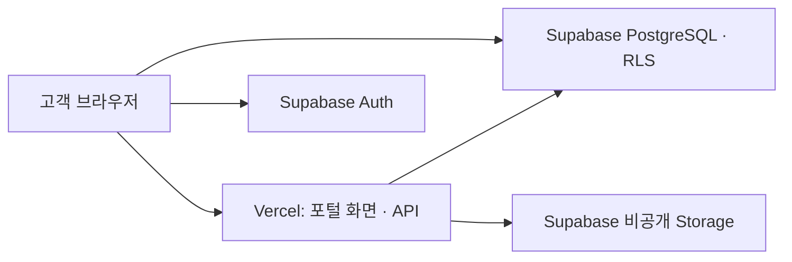

# Vercel + Supabase 개발 기반

2026-10-15 결정: 앱과 API는 **Vercel**, 로그인·PostgreSQL·비공개 파일은 **관리형 Supabase**를 사용합니다. 현재 프론트엔드를 유지하며 Convex를 중간 단계로 넣지 않습니다.



현재 배포 대상은 `portal/`을 빌드한 `dist/`와 `api/`의 Vercel Function입니다. 저장소 루트의 기존 기획용 `index.html`을 서비스 화면으로 배포하지 않습니다. 내부 메뉴는 해시로 이동하므로 전체 경로를 홈으로 바꾸는 rewrite는 필요하지 않습니다.

## 구현 상태

| 항목 | 현재 상태 |
| --- | --- |
| 선택한 2번 디자인 · 검토/콘텐츠 흐름 | 구현·브라우저 검증 완료, 가상 데이터 |
| Vercel 빌드 설정 | `vercel.json`, Node 24 권장, `npm run build` → `dist` |
| 숙소별 DB 격리 · 승인/수정 RPC | 설치 SQL 제공·사용자 적용 완료, 실제 테이블/컬럼 연결 확인; 실제 사용자 권한/RPC 실행은 미검증 |
| 비공개 다운로드 API | 사용자 인증·권한 검사 후 60초 서명 링크 발급 코드와 오프라인 테스트 준비 |
| 실제 로그인 · 화면의 DB 조회/저장 | 코드 연결 완료, 계정 생성 사용자 확인 완료; 숙소/작업 배정 필요 |
| 권한 있는 미리보기 | 별도 검토용 RPC/API 구현, 운영 서버 키·비공개 버킷 연결 확인; 실제 파일 등록·서명/재생 검증 필요 |
| 운영자 숙소/작업 배정 · 업로드 · 새 버전 · 조건 변경 | 구현 완료, 새 운영자 마이그레이션·별도 권한 적용 후 사용 |
| 게시 기록 저장 | 후속 구현 필요 |
| 실제 결제 · 이메일 · SNS 게시 | 미연동 |

체험 홈과 실제 고객 모드 `/#account`를 구분합니다. 로그인한 고객 모드는 Supabase Auth·RLS·RPC를 호출하고, 체험 홈의 가상 입력은 서버에 저장하지 않습니다. 공개 `portal/assets/`는 가상 숙소 샘플 전용이며 실제 고객 파일을 이 폴더에 넣지 않습니다.

## 계정 연결

1. Vercel 프로젝트 `staycut-snap`과 [개발 화면 배포](https://staycut-snap.vercel.app)는 완료했습니다. 최초에는 파일 직접 업로드로 배포했고, 사용자가 계정을 연결한 뒤 기존 프로젝트의 GitHub `devdevra/snap` 연결을 확인했습니다. 개발 브랜치 `codex/staycut-v2-design`, 커밋 `2cf6aa392c24ab8e17777bb361a7092a1fa7f8e6`의 Git 미리보기 빌드가 READY입니다.
2. Supabase `adyhefvhfabwkfdwwjiz` 프로젝트의 공개 설정과 인증 서버 접근, 운영 서버 키의 DB/Storage 읽기 연결을 확인했습니다. 익명 DB 접근은 `access_restricted`, 서버의 테이블/컬럼 조회와 비공개 버킷 확인은 `ready`입니다. 최초 파일 업로드 배포의 관측 리전은 `iad1`이었고, 현재 Git 기반 운영·미리보기 배포는 설정대로 `icn1`입니다.
3. Supabase의 Project URL과 publishable key를 확인합니다. 비밀 키는 아래 Vercel 환경변수에 직접 입력합니다. DB 비밀번호·개인 토큰을 채팅이나 GitHub에 올리지 않습니다.

## Vercel 설정과 환경변수

저장소 가져오기 시 **Root Directory는 저장소 루트**, Framework Preset은 Other, Node.js는 24.x로 둡니다. Build Command와 Output Directory는 `vercel.json`을 따릅니다. 현재 구현 브랜치는 `codex/staycut-v2-design`입니다. 기본 브랜치 `codex/staycut-planning`에는 앱 변경이 아직 합쳐지지 않았으므로 자동 배포 연결 후에는 구현 브랜치를 지정해야 합니다.

기존 프로젝트의 GitHub 저장소 연결과 지정한 개발 브랜치의 Git 빌드는 확인했습니다. 현재 도구는 Vercel Production Branch를 읽거나 변경할 수 없으므로 운영 브랜치를 설정했다고 주장하지 않습니다. 기본 브랜치에 구현을 합치기 전이라면 대시보드의 Production 환경 Git 브랜치를 `codex/staycut-v2-design`으로 지정하거나, 구현 PR을 검토·병합한 뒤 기본 브랜치를 사용합니다.

첫 직접 업로드 배포는 소스 커밋 `8d6f89e01fdbd622de4e78f35b3a2fae7b32d731`의 배포용 48개 파일을 Git blob 해시로 대조한 뒤 실행했습니다. Vercel이 신규 프로젝트의 첫 배포를 `production` 대상으로 생성하고 기본 `vercel.app` 별칭을 할당했습니다. 가상 데이터 데모이며 실제 고객 서비스의 운영 전환 완료를 의미하지 않습니다. [배포 검증 기록](deployment-status.json)에 대상·원본 커밋·확인 범위를 기록했습니다.

| 환경변수 | 값과 용도 |
| --- | --- |
| `SUPABASE_URL` | 프로젝트의 HTTPS URL |
| `SUPABASE_PUBLISHABLE_KEY` | `sb_publishable_…`, 사용자 JWT와 함께 인증/권한 RPC 호출 |
| `SUPABASE_SECRET_KEY` | `sb_secret_…`, 서버에서 허가된 파일의 링크 서명과 데이터 없이 연결 상태 확인에 사용 |

신규 프로젝트는 [공식 API 키 안내](https://supabase.com/docs/guides/getting-started/api-keys)의 publishable/secret 키를 사용합니다. 기존 프로젝트의 `SUPABASE_ANON_KEY` / `SUPABASE_SERVICE_ROLE_KEY`도 파일 API에서 호환하지만 새 구성에는 필요하지 않습니다. 비밀 키에는 공개 번들용 접두사를 붙이지 않습니다. Vercel 연결 도구의 환경변수 조회·등록이 403으로 거부되어 제공받은 URL과 공개 키는 `portal/public-config.json`을 사용합니다. 서버도 이 두 공개 값만 기본값으로 읽으며, 비밀 키는 서버 환경변수에서만 읽습니다.

Preview/Development에는 개발용 Supabase를 연결하고 Production에는 별도 운영 프로젝트를 연결합니다. 비밀 키는 Vercel의 Secret 환경변수로 저장합니다. `.env.example`에는 변수 이름만 있으며 `.env.local`과 `.vercel/`은 Git에서 제외합니다.

## DB 적용과 연결 순서

올바른 개발 프로젝트에 연결하고 환경변수 이름을 확인한 뒤에만 마이그레이션을 적용합니다. [Supabase 기반 안내](../supabase/README.md)에 테이블·RPC 계약과 운영자 책임을 기록했습니다.

```sh
supabase login
supabase link --project-ref <개발-프로젝트-ref>
supabase db push --dry-run
supabase db push
```

위 명령은 아직 실행하지 않았습니다. `supabase/tests/`는 임시 CI DB 전용으로 실제 프로젝트에 적용하지 않습니다. 마이그레이션 이후 테스트 사용자를 생성하고, 신뢰된 운영자 경로로 숙소·멤버십·계약·파일을 배정해야 합니다. 계정 가입만으로 고객사 접근 권한이 생기지 않습니다.

로그인 화면 → 사용자 JWT로 숙소/작업 조회 → 승인·수정 RPC → 비공개 미리보기/다운로드를 구현했습니다. 실제 프로젝트의 테이블/컬럼과 비공개 버킷 연결은 확인했습니다. [관리자 설정](supabase-setup.md)의 첫 계정·숙소·작업·파일 배정 후 실제 사용자로 저장·새로고침·파일 전달을 검증해야 합니다. 실제 Auth·Storage·Vercel 전체 흐름 검증 전에는 운영 전환이 완료된 것으로 보지 않습니다.

## 다운로드 API

`POST /api/download`, 헤더 `Authorization: Bearer <Supabase 사용자 access token>`, `Content-Type: application/json`.

```json
{"versionId":"UUID","channel":"instagram","purpose":"organic"}
```

호출자가 파일 경로나 사용자 ID를 지정할 수 없습니다. 서버는 사용자 토큰을 확인한 뒤 동일 사용자 권한으로 `authorize_asset_download` RPC를 호출합니다. RPC가 허가한 비공개 경로만 서버 비밀 키로 서명하며 `{ "url": "…", "expiresIn": 60 }`을 반환합니다. 응답은 캐시하지 않습니다. 파일 접근 철회 후에도 이미 발급한 링크는 남은 60초 이내 동안 유효할 수 있습니다.

## 검증

`GET /api/health`는 공개 설정·인증 서버와 익명 DB 접근 상태를 반환합니다. 비공개 테이블에서 `databaseStatus: access_restricted`는 예상되는 응답입니다. 서버 환경변수에 유효한 형식의 키가 있으면 고객 행을 가져오지 않는 `limit=0` 조회로 전체 앱 컬럼을 확인하고, 고정된 파일 버킷의 비공개 여부를 확인합니다. `serverKeyConfigured`는 형식 확인만 뜻하며, 실제 연결 결과는 `serverDatabaseReady/serverDatabaseStatus`와 `privateStorageReady/privateStorageStatus`로 구분합니다. 키·행·버킷 메타데이터는 응답에 포함하지 않습니다. 새 secret 키는 서버 요청의 `apikey` 헤더에만 사용합니다.

이 점검은 RPC/RLS의 실제 사용자 권한, 계정/작업 배정, 파일 존재·재생·서명 성공을 검증하지 않습니다. 해당 흐름은 실제 계정과 파일을 준비한 뒤 별도로 확인합니다.

운영자 스키마는 별도의 `operatorSchemaReady/operatorSchemaStatus`로 확인합니다. 새 운영자 테이블이 없는 상태에서도 기존 고객 스키마·비공개 버킷 상태는 각각 유지합니다. 운영자 기능에는 `202610160002_operator_uploads.sql` 추가 적용과 확인된 기존 Auth 계정에 대한 별도 운영자 배정이 필요합니다. 업그레이드할 때 신규 프로젝트용 `supabase/setup.sql`을 반복 실행하지 않습니다.

운영 API `POST /api/operator`는 사용자 JWT와 별도 활성 운영자 권한을 확인합니다. 영상은 서버를 거치지 않고 임시 비공개 경로로 직접 업로드합니다. 서버는 스트리밍으로 두 파일의 최대 50 MiB·실제 SHA-256·형식을 검증하고, 덮어쓰기 없는 최종 경로로 이동한 뒤 재검증하고 DB에 공개합니다. 최종 등록 함수는 서비스 역할만 실행할 수 있습니다. 최신 버전·수정 요청이 바뀌면 오래된 업로드를 등록하지 않습니다. 해당 함수의 실행 한도는 180초, 서버 작업 기한은 150초입니다. [운영자 안내](operator-guide.md)에 재시도와 현재 범위를 기록했습니다.

```sh
npm ci --ignore-scripts --no-audit --no-fund
npm test
npm run test:server
npm run build
```

GitHub Actions는 기존 Chromium 흐름과 별도로 임시 PostgreSQL 16에서 실제 마이그레이션/RLS/RPC 회귀 SQL을 실행합니다. Auth·Storage는 최소 인터페이스 스텁이므로 실제 Supabase 토큰 발급이나 Storage HTTP 연결을 대신 검증하지 않습니다.

2026-10-15 검증 결과: [GitHub Actions 38750549206](https://github.com/devdevra/snap/actions/runs/38750549206), 코드 커밋 `4ee8123d2d67a8c4173823a4069546a9e063d91a`에서 도메인 26개·다운로드 API 12개·DB 회귀 판정 77개·정적 빌드·Chromium 6개 항목이 모두 통과했습니다. `.vercelignore` 경로도 별도 확인하여 실제 포털 HTML/미디어/API/빌드 파일은 포함하고 루트 기획 HTML·자료·로컬 환경변수는 제외했습니다. 실제 Vercel/Supabase 종단 연결 검증은 아직 수행하지 않았습니다.

2026-10-16 갱신: 사용자의 DB 설치·운영 키 등록 완료 후 코드 `2176b31b30f77bbd8ff04859065d545419317641`을 Git에서 명시적으로 Production 배포했습니다. [CI 38765749512](https://github.com/devdevra/snap/actions/runs/38765749512)에서 단위 71개·DB 판정 103개·기존 브라우저 6개·모의 Auth/REST 브라우저 4개가 모두 통과했습니다. 운영 배포는 READY·`icn1`이며, 홈/공개 설정 200, 미리보기 API GET 405, Auth 정상, 서버 DB 컬럼·비공개 버킷 확인이 통과했습니다. 비밀 키 값은 조회하지 않았습니다. 이후 자동 Preview 커밋 `353b169`에서도 서버 키·DB 컬럼·비공개 버킷 연결을 확인했습니다. 사용자가 첫 Auth 계정을 생성했다고 알려주었으며, 숙소 연결용 관리자 SQL을 준비했으며 실제 실행·로그인 확인은 남아 있습니다. 실제 사용자 로그인·RPC 저장·파일 서명/재생의 종단 확인은 남아 있습니다. [배포 기록](deployment-status.json)에 확인 범위를 기록했습니다.

첫 숙소·owner 멤버십 연결용 [`supabase/admin/assign-member.sql`](../supabase/admin/assign-member.sql)은 기존 확인된 Auth 계정만 사용하고, 이름 충돌과 기존 멤버십·권한 변경을 거부합니다. [CI 38767936380](https://github.com/devdevra/snap/actions/runs/38767936380), 코드 `af6ce424596aa9ca9d8c6b0430ff6631d998aa18`에서 실제 템플릿 실행 22개를 포함한 DB 판정 125개·단위 71개·브라우저 10개가 통과했습니다. 개인화 파일은 저장소 밖에 준비했으며 실제 프로젝트의 SQL 실행과 로그인은 아직 수행하지 않았습니다. 해당 커밋의 자동 Preview도 서버 DB/비공개 버킷 확인을 통과했습니다.

2026-10-16 운영자 기능 배포: [CI 38772826386](https://github.com/devdevra/snap/actions/runs/38772826386), 코드 `bd5472edac0796815858375091dcd499a49fb3e4`에서 단위 116개·DB 판정 174개·체험 브라우저 6개·고객 모의 브라우저 4개·운영자 모의 브라우저 3개와 빌드가 통과했습니다. 업로드 실패/새 예약 재시도, 실제 PUT 바이트/해시, 수정 요청·최신 버전 스냅샷, 권한 거절과 모바일 가로 넘침을 확인했습니다. 운영자 데스크톱·모바일 캡처를 시각 확인했습니다.

동일 커밋의 Git 기반 Production 배포 `dpl_952ESwfxQkRUQhqZ37EvyTh6m3kj`가 READY·`icn1`입니다. 운영 홈과 운영 JS/CSS는 200이며 테스트한 소스와 일치하고, 운영 API는 GET 405·POST 전용·no-store입니다. 기존 Auth·고객 DB·비공개 버킷은 정상입니다. 새 운영자 스키마는 `missing_schema`이므로 실제 운영자 업로드가 가능한 상태로 전환되지는 않았습니다. 관리자가 기존 프로젝트에 추가 마이그레이션과 명시적으로 선택한 운영자 배정을 한 트랜잭션으로 적용하도록 비공개 파일을 준비했습니다. 해당 파일에는 PostgREST 스키마 캐시 새로고침도 포함합니다. 실제 영상 등록·고객 승인/다운로드의 운영 종단 검증은 적용 후 진행해야 합니다.

2026-10-16 운영자 SQL 적용 후 확인: 사용자가 비공개 설치 SQL 실행을 완료했다고 알려주었고, 운영 `/api/health`에서 `operatorSchemaReady: true`, `operatorSchemaStatus: ready`를 확인했습니다. 기존 고객 DB·Auth·비공개 버킷도 정상입니다. 확인된 것은 테이블/컬럼 연결이며, 실제 계정의 운영자 화면 접근과 영상 업로드·고객 승인·다운로드 전체 검증은 남아 있습니다.
